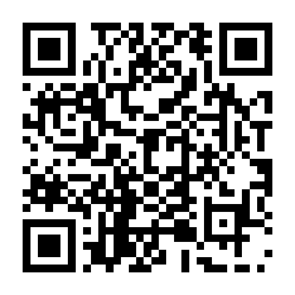

# 皇居ランナー（Kokyo Runner）

ロードバイクで皇居を一周（約6km）するブラウザ 3D ゲームです（three.js）。
二重橋前をスタートして、大手門・竹橋・九段下（武道館）・千鳥ヶ淵・半蔵門・三宅坂・桜田門をまわり、二重橋前に戻ってきます。
ランナーや歩行者、車やバイクをよけながら走り抜けます。

- 建物は国土交通省 PLATEAU、地形と水面は国土地理院、道路と車線数は OpenStreetMap の実際のデータです（街のデータは [ターザン大東京](https://github.com/techgymjp/tarzan) から）
- ステージは 朝 → 昼 → 夕方 → 夜。ゴールすると次のステージが開きます。昼以降は鬼が追いかけてきます
- 日本語 / English（ブラウザの言語で自動。タイトル画面で切り替え）

## 遊ぶ

- Web 版: https://techgymjp.github.io/kokyo/
- 手元で動かす: このフォルダで `python3 -m http.server 8000` → http://localhost:8000/ （ES Modules を使うので `file://` では動きません）
- 遊び方はタイトル画面の「遊び方」（`howto.html`）

## Android アプリ

Capacitor で Web 版のファイルをアプリに同梱しています（オフラインで遊べます）。パッケージ名は `jp.techgym.kokyo`。

- 動作確認用 APK（テスト広告）: https://github.com/techgymjp/kokyo/releases/tag/android-latest
- APK を直接: https://github.com/techgymjp/kokyo/releases/latest/download/kokyo-runner.apk



- ビルドは GitHub Actions（`.github/workflows/android.yml`）。`main` に push すると、上のリリース画面の APK が差し替わります
- GitHub Secrets（`ANDROID_KEYSTORE_BASE64`・`ANDROID_KEYSTORE_PASSWORD`・`ANDROID_KEY_ALIAS`・`ANDROID_KEY_PASSWORD`）を登録すると、Google Play 用の署名付き AAB（本番広告）も Artifacts に出ます
- 広告（`js/ads.js`）
  - バナー: タイトル・遊び方・ポーズ・結果画面だけ（プレイ中は出さない）
  - 全画面広告: プレイを始めるとき・タイトルに戻るとき・ポーズからの再開・もう一度 / 次のステージのたび
  - リワード広告: ぶつかったときに見ると、ぶつかる少し前から続きを走れる（1 ゲーム 3 回まで。結果とシェア文に「やり直し」の回数）
- 本番の広告ユニット ID は `js/ads.js` の `production`、AdMob のアプリ ID は `android/app/src/main/res/values/strings.xml` の `admob_app_id`
- Web 版の公開（GitHub Pages）も `scripts/build-web.js` で作る `www/` を公開します

手元でビルドするとき（Android Studio が必要）:

```sh
npm ci
npm run android:sync
npm run android:open
```

## データの作り方

`tools/` のスクリプトで、ターザン大東京のデータの切り出し（`crop_from_tarzan.py`）、コースと車線数（OpenStreetMap）、標高（国土地理院 DEM）を作っています。

## クレジット

- 建物: 国土交通省 Project PLATEAU 3D都市モデル 東京都23区（2020年度）。一部は plateau-tokyo23ku-building-mvt-2020（indigo-lab）から
- 標高・水面・道路: 国土地理院 ベクトルタイル・標高タイル
- 道路の線と車線数: © OpenStreetMap contributors（ODbL）
- 街のデータと一部の名所のモデル: [ターザン大東京](https://github.com/techgymjp/tarzan)
- three.js（MIT, `vendor/three.LICENSE`）

## ライセンス

著作権はテックジム株式会社に帰属します（All rights reserved）。許可なく複製・改変・再配布すること、Web サイトやアプリ（Google Play、App Store など）として公開・販売すること、名前・ロゴ・アイコン・画像を使うことを禁止します。
テックジムの受講生が学習目的で複製・改変することは許可しますが、アプリストアでの公開・広告の掲載・販売などの商用利用は禁止し、著作権表示を残してください。
同梱のライブラリと地図・都市モデルのデータは、それぞれのライセンスと利用規約に従います。詳しくは [LICENSE](LICENSE) をご覧ください。
